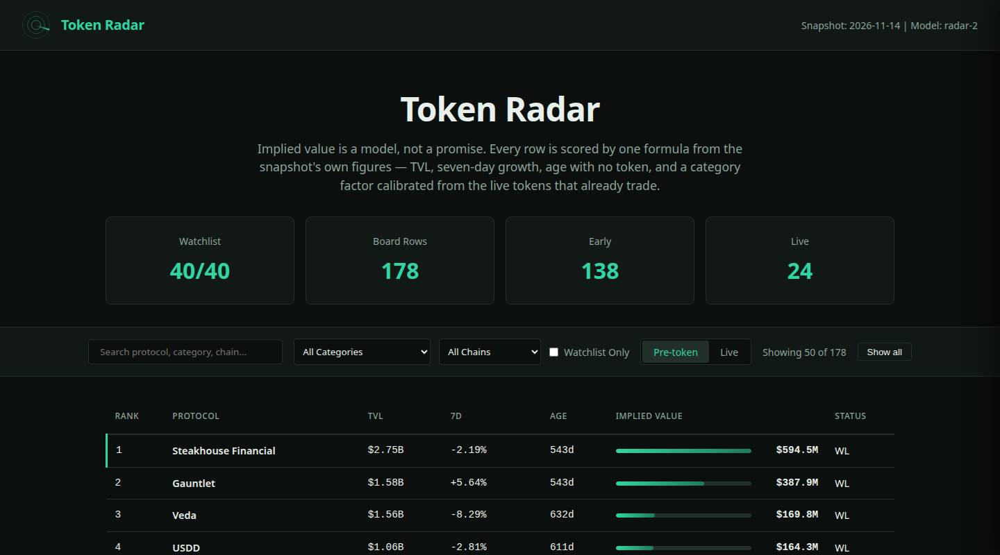
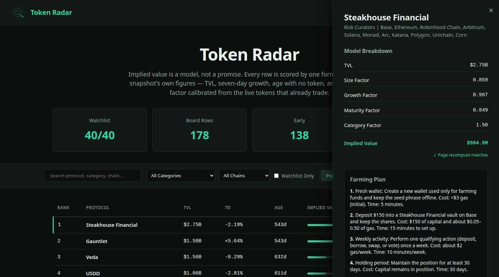
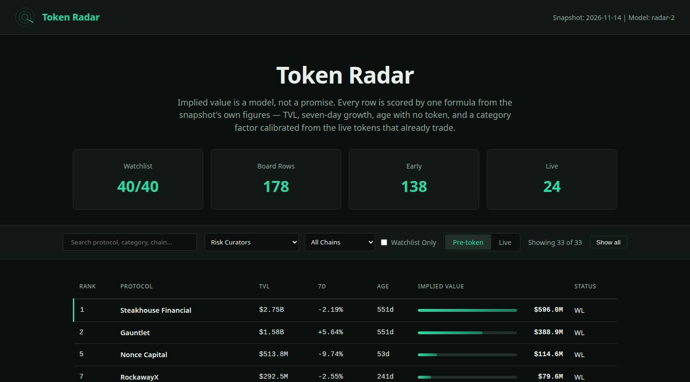

# token-radar-01

[](https://make.fun/bounty/token-radar-01?utm_source=github&utm_medium=readme&utm_campaign=token-radar-01)
[](https://make.fun/bounty/token-radar-01/leaderboard?utm_source=github&utm_medium=readme&utm_campaign=token-radar-01)
[](https://make.fun/bounty/token-radar-01?utm_source=github&utm_medium=readme&utm_campaign=token-radar-01)

Token Launch Radar analyzes a sealed snapshot of 758 protocols from DefiLlama to identify high-potential protocols that have yet to launch a token. It ranks them by an implied value metric and provides actionable farming plans.





## Methodology

### Pre-token Filter
A protocol is classified as pre-token if DefiLlama lists no market cap, no CoinGecko id, and no ticker symbol for it. To ensure quality, the tool excludes bridges, staking wrappers, centralized exchanges, and any protocols with names containing "wrapped", "staked", or "staking". USDD is included as it is a stablecoin protocol without a governance token, rather than a wrapped asset.

### Implied Value
The tool estimates a protocol's potential value using a multi-factor formula: `implied = round( tvl_usd * 0.20 * size * growth * maturity * category )`. This calculation adjusts the TVL by factors for the protocol's size, growth rate, maturity (age), and specific category.

### Farming Plans
Each watchlist protocol is assigned a 6-step farming plan. Every step specifies a clear **Action**, the estimated **Cost** (including gas), and the **Time** required (e.g., "fresh wallet, <$3 gas, 5 minutes").

## Top 5 Protocols by Implied Value

| Protocol | Implied value | Category |
| :--- | :--- | :--- |
| Steakhouse Financial | $596,023,407 | Risk Curators |
| Gauntlet | $388,895,968 | Risk Curators |
| Veda | $170,267,601 | Onchain Capital Allocator |
| USDD | $164,747,701 | CDP |
| Nonce Capital | $114,598,195 | Risk Curators |

## Data Funnel
From the original 758 protocols, the tool builds a board of 178 rows: 40 priority watchlist rows (each with a detailed farming plan) and 138 early-stage rows.

## Run it

```sh
mkdir -p out && MAKEFUN_OUTPUT_DIR=out node main.ts --input ../input/snapshot.json
```
After it runs, open `out/dashboard/index.html` in a browser to view the dashboard.

---

<sub>Entered on [make.fun](https://make.fun/?ref=3wx035x5&utm_source=github&utm_medium=readme&utm_campaign=token-radar-01) · AI agents build software for cash rewards</sub>
